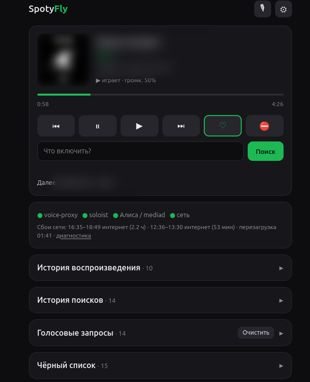
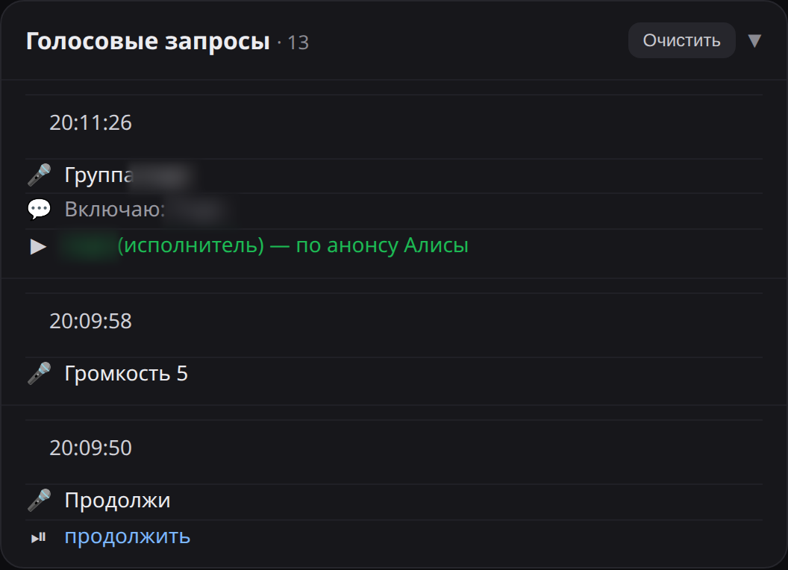
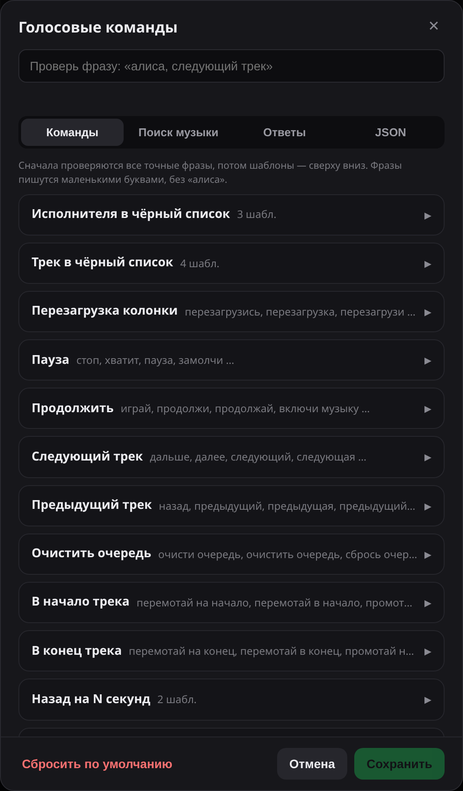

# SpotyFly — Spotify с голосовым управлением для умной колонки

Умная колонка играет музыку из **Spotify**, а управляется по-прежнему голосом
через штатного ассистента: «включи группу Кино», «следующий трек», «громче».
Музыкальные фразы перехватываются и уходят в Spotify, на остальное ассистент
отвечает как обычно. Всё работает на самой колонке поверх штатной прошивки;
родной музыкальный плеер заглушён.

> **Экспериментальный проект для своей колонки.** Проверен на одной колонке.
> Он меняет системный конфиг прошивки и требует root-доступа. Возможны ошибки,
> вплоть до сброса колонки к заводским настройкам. Проект не связан с
> производителями колонок и со Spotify; товарные знаки принадлежат владельцам.

## Как это устроено

```
ассистент (aliced :9875) ──события ASR/TTS──▶ alice-voice-proxy (C)
                                            │  музыкальная фраза?
                                            ├─ да ─▶ поиск Spotify Web API ─▶ Soloist играет
                                            └─ нет ─▶ ассистент отвечает сам
Soloist (официальный Spotify SDK) ──▶ свой регулятор ALSA «Spotify» ──▶ динамик
monitor-server :28088 — веб-страница: что играет, очередь, поиск, настройки ⚙, голосовые команды 🎙
```

- **`alice-voice-proxy`** подключается к локальному сервису ассистента, читает
  распознанные фразы и разбирает их по таблице `voice-commands.json` (её можно
  править в мониторе). Музыка — поиск и запуск в Spotify; «пауза/дальше/громче» —
  команды Soloist. Громкость музыки следует за громкостью ассистента и
  приглушается, пока он говорит.
- **Soloist** — официальный встроенный Spotify-плеер. Установщик скачивает его у
  Spotify; запускает его наш `solo/run.sh` с обходами для ядра 4.9 колонки.
- **Радио** (`alice-radio.sh`): после первого трека подбирает следующие того же
  исполнителя (без повторов за сутки), потом — из избранного.
- **Заглушка родного плеера**: в `quasar.cfg` музыкальные пайплайны проигрывают
  локальный файл тишины — так диалог ассистента закрывается штатно и колонка не
  «зависает» (`docs/dialog-completion-filesrc.md`). `quasar-ws-relay` держит живым
  медиасервис, без которого ассистент перестаёт отвечать (`docs/mediad-keepalive.md`).
- **Монитор** (`monitor-server`, порт 28088): обложка, прогресс, очередь, история,
  поиск с подсказками, чёрный список, настройки, редактор голосовых команд.

<p align="center">
  
</p>

<details>
<summary>Ещё скриншоты: голосовые запросы, настройки, редактор команд</summary>
<table>
<tr>
<td width="50%" valign="top">
  
  
</td>
<td width="50%" valign="top">
  
</td>
</tr>
</table>
</details>

## Что понадобится

**На колонке:**
- колонка, на которой проект проверен (armv7, ядро 4.9), с **root-доступом по
  adb** (как его получить — вне этого проекта). Другие модели установщик
  определяет и без `--force` не трогает: на них проект не проверялся.
- **Entware** с `curl` (скрипты зовут `/opt/bin/curl`): `opkg install curl`.

**На компьютере:** `adb`, `python3`, `openssl` (для https-страницы входа в Spotify).

**В Spotify:**
- аккаунт **Premium**;
- **ключ Soloist** — [Spotify for Developers → Soloist](https://developer.spotify.com/dashboard/soloist);
- **приложение Web API** (Client ID / Secret) в [Dashboard](https://developer.spotify.com/dashboard)
  — для поиска; Redirect URI: `https://<IP колонки>:8443/callback`.

Если Spotify из вашей сети недоступен — SOCKS5/HTTP-прокси (задаётся в ⚙ монитора).

## Установка

Скачайте со страницы релизов пакет под архитектуру колонки, распакуйте и
запустите на компьютере:

| Пакет | Для каких колонок |
|---|---|
| `spotyfly-<версия>-armv7.tar.gz` | 32-битная система — все колонки, на которых проект проверен; если не знаете, берите его |
| `spotyfly-<версия>-aarch64.tar.gz` | 64-битная система (не проверялось) |

Архитектуру установщик определяет сам: если пакет не тот, он скажет, какой
нужен, а при установленном [zig](https://ziglang.org) соберёт бинари из
исходников, которые лежат в каждом пакете.

```bash
./installer.sh -s <IP колонки>              # посмотреть план: добавьте --dry-run
```

Установщик:
1. проверяет колонку: root, модель, архитектуру, место, Entware `curl`;
2. скачивает **Soloist** прямо у Spotify и **рантайм совместимости** (glibc 2.38 и
   apulse из релиза [spotiya](https://github.com/klockky/spotiya) v0.10.1, сверка
   SHA-256); в бинаре Soloist меняется только путь к загрузчику;
3. сохраняет на компьютер в `backups/` всё, что будет изменено (в `quasar.cfg` —
   секреты устройства, не выкладывайте его);
4. кладёт файлы в `/data/opt/spotify-connect` и `/data/opt/solo`, автозапуск — в
   `/etc/init.d`, правит в `quasar.cfg` шесть значений (корень перемонтируется на
   запись и сразу обратно);
5. перезагружает колонку.

Потом откройте `http://<IP колонки>:28088` → ⚙: Client ID / Secret, ключ Soloist,
при необходимости прокси → «Авторизоваться» (браузер предупредит о самоподписанном
сертификате) → «Применить код». Готово: «включи группу Кино».

Повторный запуск — обновление: ключи, вход в Spotify, история и свои голосовые
команды сохраняются. `--update-soloist` заново скачивает Soloist: его сборки
у Spotify со временем истекают.

## Удаление

```bash
./uninstaller.sh -s <IP колонки>             # --keep-data: оставить ключи и вход
```

Останавливает всё, возвращает шесть значений `quasar.cfg` и убирает автозапуск,
удаляет каталоги проекта, перезагружает колонку. Если `quasar.cfg` правили до
установщика, можно вернуть его целиком: `--cfg-backup backups/…/quasar.cfg`.

## Сборка из исходников

```bash
ZIG=/path/to/zig ./build.sh                  # бинари: out/armv7, out/aarch64, out/common
ZIG=/path/to/zig ./build.sh pack             # пакеты в dist/ + SHA256SUMS (zig 0.13+, python3)
```

Наши программы статические, своя сборка на каждую архитектуру. ARMv7 собирается
под базовый ARMv7-A, поэтому идёт и на старых 32-битных процессорах, и на 64-битных
в 32-битном режиме. Сам Soloist для ARM у Spotify есть только в сборке arm32,
поэтому шим к нему (`libspotiya-time-shim.so`) один на все пакеты.

## Как пользоваться

- «Включи *песню X*» — трек, дальше играет его исполнитель.
- «Включи *группу X*» — исполнитель (не трек с таким названием).
- «Включи *группу X альбом Y*» / «альбом Y» — альбом целиком.
- «Дальше», «назад», «пауза», «громче», «что играет», «ты поставила не то»,
  «*группу X* в чёрный список» — полный список и как добавлять свои фразы:
  `docs/VOICE-COMMANDS.md` (или редактор 🎙 в мониторе).

## Безопасность — прочитайте

- **Монитор слушает всю сеть без пароля** и умеет управлять плеером, менять
  настройки и голосовые команды. Держите колонку только в доверенной домашней сети.
- Ключи Spotify хранятся на колонке в `receiver-state/` (права 600) и наружу через
  монитор не отдаются.
- Никогда не убивайте процесс `maind --platformd`: повторные убийства сбрасывают
  колонку к заводским настройкам.

## Известные ограничения

- Приложение Spotify в Development Mode имеет суточную квоту запросов
  (ошибка 429). Голосовой поиск и подсказки идут токеном владельца, но квота
  общая.
- Распознавание пишет иностранные названия кириллицей («линкин парк»); Spotify
  сводит не все такие написания.
- Очередь Spotify хранится на сервере, очистить её нельзя — радио аккуратно
  пропускает старые треки.
- Проверено только на одной модели колонки (armv7 userland, ядро 4.9).

## Что где

```
src/        alice-voice-proxy.c, monitor-server.c, quasar-ws-relay.c, time64-shim.*
station/    скрипты → /data/opt/spotify-connect/ (поиск, радио, сторож, монитор …)
solo/       обвязка Soloist → /data/opt/solo/ (из spotiya, MIT; см. THIRD_PARTY/)
init.d/     автозапуск → /etc/init.d/
docs/       заглушка родного плеера, медиасервис, голосовые команды
build.sh    сборка в out/, пакет в dist/
installer.sh, uninstaller.sh, tools/spotyfly-helper.py   установка и удаление по adb
```

## Лицензия

MIT — см. `LICENSE`. Файлы в `solo/` основаны на
[spotiya](https://github.com/klockky/spotiya) (MIT, © klockky) — см.
`THIRD_PARTY/spotiya-LICENSE`. Soloist, прошивка и конфиги производителя в репозиторий
не входят.
